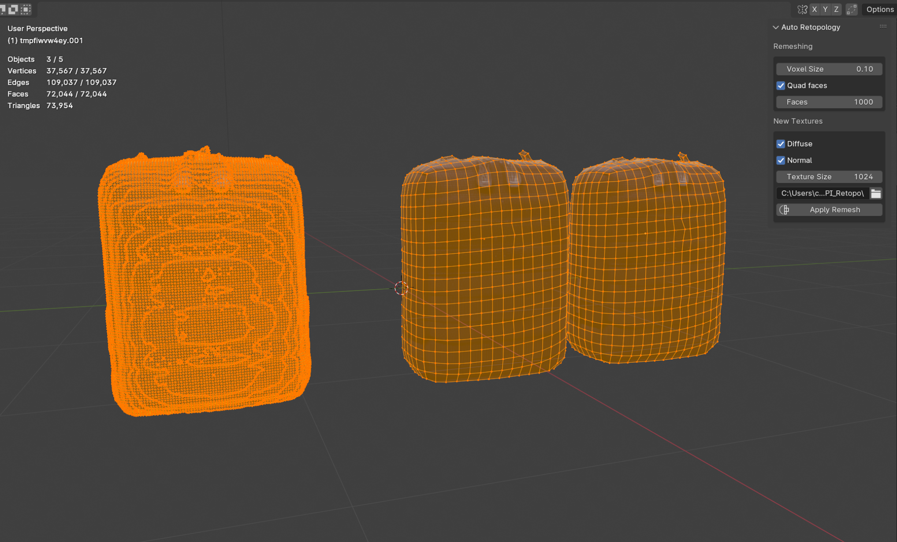

# AutoRetopo
A simple retopology and re-texturing tool that is suited for high poly meshes (photogrametry, AI generated 3D models etc). 
The output is a duplicate of the selected mesh with a optimized, lower polycount and with quad faces, and a new UV map and textures.

**instructions:**

1. Download this repo as a zip file
2. Open Blender, go to Edit and click on Preferences
3. Choose install and find the downloaded zip file (autoRetopo)
4. Enable it by checking the tickbox, it should appear in the sidebar in the 3D viewport

**To be added in the future:**

- AO map
- Roughness map 
